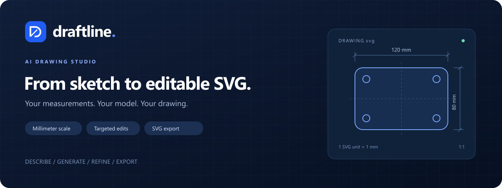
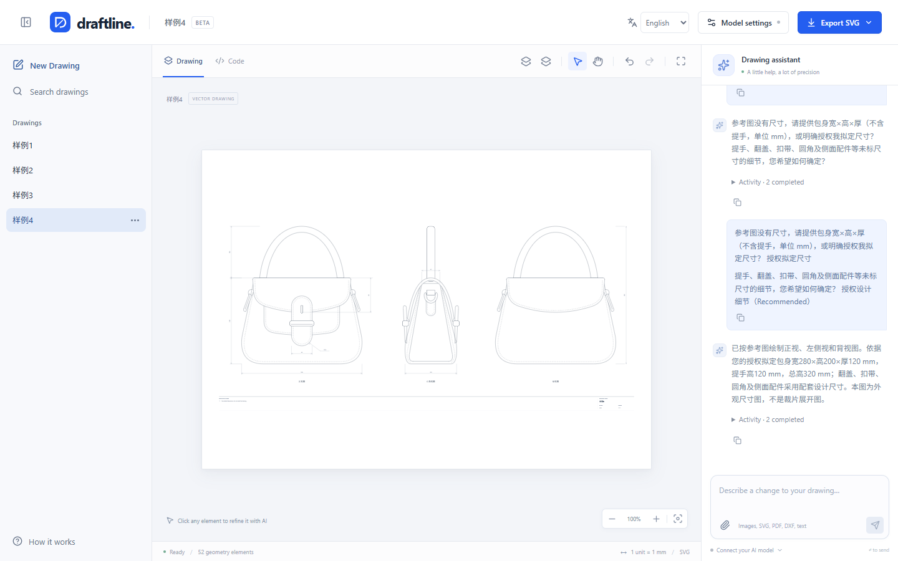

<p align="center">
  
</p>

<p align="center">
  <strong>Describe it. Draw it. Keep refining it.</strong><br />
  Turn sketches, reference files and measurements into editable millimeter SVG drawings.
</p>

<p align="center">
  <a href="https://draftline.anxinsm.com">Live demo</a> ·
  <a href="#quick-start">Quick start</a> ·
  <a href="docs/user-guide.md">User guide</a> ·
  <a href="README.md">简体中文</a>
</p>

<p align="center">
  <a href="LICENSE"></a>
  <a href="https://www.typescriptlang.org/"></a>
  <a href="wrangler.jsonc"></a>
</p>



## What you can do

Draftline is an open-source AI drawing workspace. Supply a sketch and dimensions, generate a drawing, then select objects and refine them through conversation. Each project keeps its own references, conversation and undo history.

| Feature               | How it works                                                                                                            |
| --------------------- | ----------------------------------------------------------------------------------------------------------------------- |
| Sketch to drawing     | Describe a part or attach images, SVG, PDF, DXF or text; AI asks for essential missing measurements                     |
| Targeted edits        | Select objects, draw a marquee or enter groups; changes beyond the selection require review                             |
| Source editing        | Inspect, edit and format HTML / SVG / JavaScript in CodeMirror, then validate changes in the sandbox                    |
| Millimeter SVG export | One SVG unit equals 1 mm; export geometry only or a drawing with dimensions, title block and notes                      |
| Separate projects     | Autosave drawings, conversations, attachments and drafts; undo / redo and switch projects during generation             |
| Your choice of model  | Bring an OpenAI-compatible endpoint or NewAPI instance and your own API key; replies and activity stream as they arrive |
| Two languages         | Simplified Chinese by default, with instant English switching and desktop, tablet and mobile layouts                    |

## Try the workspace

1. Open the **[live demo](https://draftline.anxinsm.com)** and explore four editable samples.
2. Enter your Base URL, API key and model in **Model settings**, then test the connection.
3. Create a drawing, describe its dimensions or attach references, and answer any measurement questions.
4. Select objects to refine, review proposed changes and export SVG.

An example instruction:

> Draw a 120 × 80 mm rectangular plate with 8 mm corner radii. Add a centered 20 mm diameter hole and dimension the outline and hole.

Choose a model with **streamed tool calling**. Image and PDF input also require support from the model and endpoint. Attach up to 10 files totaling 8 MB per message. Your model provider charges for API usage.

## Quick start

Requires **Node.js 24.11+** and npm.

```bash
git clone https://github.com/jiachaoDing/draftline.git
cd draftline
npm ci
npm run dev
```

Open <http://127.0.0.1:3000> and configure your endpoint in Model settings. Vite proxies API requests to the local server on port `3001`.

| Provider                     | Example Base URL                                                                |
| ---------------------------- | ------------------------------------------------------------------------------- |
| OpenAI                       | `https://api.openai.com/v1`                                                     |
| NewAPI / compatible endpoint | `https://your-api.example.com/v1`; preserve the provider's required path prefix |

Local development accepts localhost HTTP providers. Production uses public HTTPS endpoints.

## Deploy to Cloudflare Workers

**Workers Static Assets** serves the frontend; the same Worker runs the Hono API.

```bash
npx wrangler login
npm run deploy
```

Before deploying your own instance, replace the hostname in [wrangler.jsonc](wrangler.jsonc) with a domain you manage in Cloudflare. Wrangler configures its custom domain and HTTPS certificate. For Git integration, use `npm run build` as the build command and `npx wrangler deploy` as the deploy command.

Preview production routing with `npm run build` followed by `npm run dev:worker`. For Node hosting, run `npm run build` followed by `npm start`. See the [development guide](docs/development.md#cloudflare-deployment-checks) for more.

## Data and execution

- **Projects stay in browser storage.** IndexedDB holds drawings, conversations and attachments, scoped to the current origin and browser profile. Export important drawings for safekeeping.
- **You manage model credentials.** Settings use browser local storage; requests pass through the application server to your selected provider. Credentials are kept separate from drawing prompts, project records and exports.
- **Validation precedes commits.** Generated code runs in an isolated iframe and passes sanitization and SVG checks before entering drawing history. Cancellation, failures and incomplete responses preserve the committed drawing.
- **Review generated measurements.** The application checks structure and scale conventions; users must verify geometric relationships and suitability for their intended use.

## Stack and documentation

| Layer                      | Main libraries                                                |
| -------------------------- | ------------------------------------------------------------- |
| UI and conversation        | React, TypeScript, Vite, assistant-ui                         |
| Drawing and source editing | SVG, CodeMirror 6, Prettier, DOMPurify, svg-pan-zoom          |
| Incremental edits          | OpenAI Codex Rust apply-patch engine compiled to browser WASM |
| API and streaming          | Hono, OpenAI JavaScript SDK, SSE, Zod                         |
| Storage and deployment     | IndexedDB / idb, Cloudflare Workers / Static Assets           |
| Verification               | Vitest, Playwright, Biome                                     |

- [User guide](docs/user-guide.md): attachments, shortcuts, groups, clarification, export and security boundaries.
- [Architecture](docs/architecture.md): module responsibilities, data contracts and request lifecycle.
- [Development](docs/development.md): checks, browser setup, debugging and deployment.
- [Contribution conventions](AGENTS.md): code boundaries and behavior to preserve.

## Contributing

[Issues](https://github.com/jiachaoDing/draftline/issues) and pull requests are welcome. Include reproduction steps, browser version and a minimal example when reporting a bug. Remove credentials and private attachments before sharing.

```bash
npm run verify:all
```

This runs formatting, lint, type checks, unit tests, build and browser regressions. Browser installation instructions are in the [development guide](docs/development.md).

## License and acknowledgments

Draftline is licensed under the [MIT License](LICENSE).

The incremental patch engine and clarification interaction reuse open-source [OpenAI Codex](https://github.com/openai/codex) implementations. Sources, adaptations and Apache-2.0 notices are recorded in [third_party/codex](third_party/codex/README.md) and the [patch engine attribution](third_party/codex/apply-patch/README.md). Third-party code retains its own licenses and notices.
